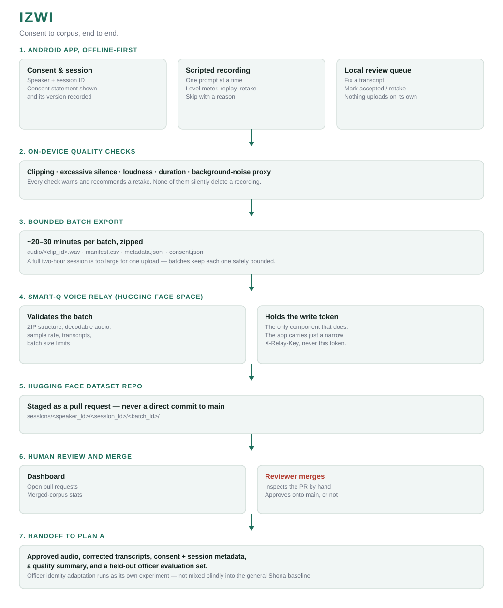

# Izwi

[](https://github.com/Quantilytix/izwi_collect/releases/latest/download/app-debug.apk)
[](https://github.com/Quantilytix/izwi_collect/releases/latest)

`izwi` is Shona for "voice." Offline-first capture of Smart-Q's production Shona voice, recorded from a single consented speaker in Zimbabwe. Sibling of [Injini](https://github.com/rapha18th/injini), Smart-Q's acoustic-monitoring app, and built on the same field-tested pattern: record offline, review before anything leaves the phone, sync only when told to, stage every upload as a pull request, let a person merge it.

The link above always points at the current release. Download it straight to a phone, allow installs from the browser or file manager when asked, and install. Debug-signed, no Play Store, this is an internal-recording build.

## The idea

Smart-Q's voice replies need a Shona voice its users already recognise. Two tracks feed that goal: an internal benchmark measuring the best Shona TTS buildable today from existing open datasets and checkpoints, and Izwi, the actual production track, capturing a real Smart-Q speaker's voice under explicit consent, staged and reviewed before it ever trains anything.

**Scope: the bot's outgoing replies, not modeled user speech.** Every prompt in the script is something Smart-Qx's TTS itself would say back to a user — a confirmation, a report, a reminder, a warning, a proactive notification — never a question posed to the bot, a request for it to repeat itself, or human-to-human conversation. That's the actual training target: what goes out as feedback and responses, checked directly against how `smart-w`'s `narrate_for_tts` (ADR 0047) and `_grounded_sales_insight` narrate reports and coaching insights in production.

The app borrows Injini's proven shape rather than inventing a new one: offline-first recording, visible capture feedback, a local queue and retry, an explicit sync action, metadata-rich exports, server-side validation, Hugging Face pull-request staging, and human review before data enters the training branch. It shares none of Injini's machine-monitoring concepts.

**Consent screen note.** The consent gate is switched off for this internal recording pass — `SessionSetupActivity` is the launcher and just takes a speaker ID. `ConsentActivity` and its full consent copy are kept in the codebase untouched and get wired back in as the launcher the moment this ships to a public or external speaker.

## Architecture

Consent to corpus, end to end.



## The pipeline

| Stage | What | Where |
|---|---|---|
| Session setup | Speaker ID, language (Shona or isiNdebele, remembered per speaker), session ID, script version | `SessionSetupActivity.kt` (consent-gated `ConsentActivity.kt` kept for later) |
| Prompts | Search, status filters, per-category counts and overall progress for 6,106 prompts; tap any prompt to record it. Edit text in place: same id, version up by one. One active script pack per language, chosen from bundled packs or an imported file, each with its own edited copy. Record this category resumes that category's own position | `ScriptEditorActivity.kt`, `PromptAdapter.kt`, `PromptSearch.kt`, `ScriptStore.kt`, `ScriptRepository.kt` |
| Recording | Mono PCM WAV, 24 kHz preferred, 16 kHz fallback, live level meter, edit-prompt-before-recording, optionally scoped to one category or to the list she jumped from. A Prompts button opens search and jump. Back steps to the previous prompt; on a prompt that already has a take, Skip reads Next. Each take records its language and prompt version. The screen stays on during a take, and a forgotten take stops at 5 minutes | `WavRecorder.kt`, `LevelMeterView.kt`, `RecordingActivity.kt` |
| Quality checks | Clipping, excessive silence, loudness, duration, background-noise proxy — warns, never deletes. `reports_and_insights` gets its own longer duration range (10–35s target, not 3–8s) since it's spoken paragraphs, not short phrases. Free-form categories (`free_form*`, `own_words`) take 20 to 120 s as normal, with hard bounds of 3 to 180 s | `QualityAnalyzer.kt` |
| Review queue | Transcript correction (forces a retake, since edited text stops matching recorded audio), accept/retake toggle (marking a retake opens the recorder on that prompt), session summary, cumulative 2h-baseline/5h meter | `ReviewQueueActivity.kt`, `SessionMeterView.kt` |
| Export | Bounded ~20–30 minute zip batches, one language each: `audio/`, `manifest.csv`, `metadata.jsonl`, `consent.json`. `prompt_id` and `category` (v0.6.0) and `prompt_version` (v0.7.0) are the last manifest columns, in that order, and fields in each metadata line | `BatchExporter.kt` |
| Upload | Relay call authenticated by a narrow `X-Relay-Key`, WorkManager retry on one enqueued attempt, never automatic. Unique work per batch id (`KEEP`), so a batch is never in flight twice | `RelayClient.kt`, `UploadWorker.kt` |
| Relay | Validates structure, audio, sample rate, and transcripts; opens a pull request; holds the only HF write token | `../smart-q-voice-relay` (FastAPI, Hugging Face Space) |
| Dataset | Every batch lands as a PR under `sessions/<speaker_id>/<session_id>/<batch_id>/`, never a direct commit | `rairo/smart-q-shona-voice-corpus` (private) |
| Dashboard | Open PRs and merged-corpus stats, read-only | `../smart-q-voice-dashboard` (Streamlit, Hugging Face Space) |

## v0.7.0: find any prompt, fix it in place, record isiNdebele

Built from Audry's feedback on v0.6.0. Three changes.

**One Prompts screen.** It opens from session setup, from the review queue, and from the Prompts button at the top of the recorder.

- Search matches prompt text, prompt id, category and the transcripts of her takes. Case and accents are ignored. Results follow a short pause in typing.
- Filter chips, each with a count: All. Outstanding, a prompt with no accepted or warning take. Recorded, a prompt with an accepted or warning take. Needs retake, a prompt whose latest take is a retake, a warning or a skip.
- A category picker shows recorded and total prompts per category, least recorded first. Record this category resumes that category's own position, as in v0.6.0.
- The header shows the language's overall progress.
- Each row shows status, take count, id and version. Tapping a row opens the recorder on that prompt inside the list on screen. Next and Back walk that list, and the saved session position follows her.
- Take status for every prompt comes from one grouped query. Rows are built and filtered off the main thread, and the list is a `ListAdapter` with `DiffUtil`.

**Fix text in place.** Every row has Edit, and the recorder has Edit prompt (a long press on the prompt works too). A save lands at once in the active script under the same id. The prompt's `version` goes up by one (every prompt starts at 1) and `edited_at` records the time. Takes keep the transcript they were recorded with, and each take stores the version it was read from. A row whose kept takes all came from older text reads "Text changed since this take", and the prompt still counts as recorded. Both screens save through `ScriptRepository.editPromptText`.

**isiNdebele.** The language field carries ISO 639-1 codes: `sn` for Shona, `nd` for North Ndebele (ISO 639-3 `nde`). Session setup offers Shona or isiNdebele and remembers the choice per speaker. The Prompts screen switches language mid-session. Each language keeps its own active script, progress and saved positions. Every clip takes the session's language, and sync groups clips by language first, so each upload batch holds one language.

**Script packs.** The pack line on the Prompts screen opens a chooser for the language on screen: the bundled packs, earlier imports, and Import a file.

| Language | Pack | Asset |
|---|---|---|
| Shona | Shona read script | `script_v1.json`, 6,106 machine-drafted prompts |
| Shona | Shona free-form | `script_freeform_v1.json`, 75 English cue prompts |
| isiNdebele | isiNdebele free-form | `script_nd_freeform_v1.json`, the same 75 cue prompts |

Each pack keeps its own edited copy in `files/scripts/<language>/<pack>.json`, so every edit survives a pack switch. Reset puts back a bundled pack's shipped text under new version numbers. The isiNdebele pack comes from the Shona free-form pack (`python tools/make_nd_freeform.py app/src/main/assets/script_freeform_v1.json app/src/main/assets/script_nd_freeform_v1.json`): the same English cue cards, ids prefixed `nd_`, every Shona instruction reading Ndebele, and a session-start price sentence described in English for her to say in Ndebele. Its prompts are English only. Prompt ids stay unique across languages: isiNdebele ids carry the `nd_` prefix, imports and added prompts included.

**Export.** `prompt_version` is the new last `manifest.csv` column, after `prompt_id` and `category`, and a field in each `metadata.jsonl` line. The relay accepts extra columns.

**Upgrading from v0.6.0.** Install over v0.6.0 and unsynced takes stay. Room migrates the database from version 2 to 3, adding `promptVersion` with 1 for every earlier take, and the destructive fallback is gone. On first launch the v0.6.0 script, `files/scripts/active_script.json` with her edits, is copied byte for byte into the Shona slot its ids match: her edited read script, or the free-form pack she imported. A copy stays as `active_script.v060.json`. Its prompts read as version 1, and the saved positions move with it.

**Tests.** `./gradlew testDebugUnitTest` covers search matching, status rules, the version bump, the export column, one language per batch, packs and the v0.6.0 script migration, and the Room migrations against a real SQLite and the exported schemas in `app/schemas`.

## Verified on device

Tested end to end on a physical Android phone, 2026-09-17: session setup, recording, on-device quality analysis, review queue, bounded batch export, and relay upload, confirmed against a real pull request on the dataset repo (closed afterward — it was a rehearsal pass, not real speech).

That pass caught three real bugs, now fixed: the `DayNight` theme rendered body text invisible against a background forced to white; `android:attr/borderlessButtonStyle` under `MaterialComponents` rendered every enabled text button white-on-white; and a stale quality warning survived tapping Retake.

Not yet done: an actual recording session with the real speaker reading real prompts (this pass only exercised the pipeline mechanically), and a full ten-clip go/no-go rehearsal.

A second device pass caught three more issues, also fixed: the review queue and sync status headers sat under the status bar, their bottom buttons sat under the navigation bar, and there was no way to fix a prompt's wording before recording it.

A third pass added `reports_and_insights` (1,068 prompts, deliberately long-form) and per-category recording navigation, and verified live: category counts update in real time as clips are accepted, a 20-second report-style clip is accepted cleanly under the long-form duration range instead of being flagged for a forced retake, and tapping Record on a category correctly resumes that category's own position across visits.

That per-category Record action initially had a touch target about 12dp tall — a plain `TextView`, not a real button, so taps mostly missed. Fixed with a properly sized button, verified by tapping it directly on device.

A fourth pass caught a scope problem, not a bug: two categories (`confirmations_clarifications`, `natural_conversation`) were written as things a *user* says to the bot, not what the bot says back — outside what's needed right now. Removed both after user feedback; every remaining category was audited against "is this something the bot itself would say" and confirmed clean.

## Android: from consent to corpus

**Session setup** takes a speaker ID and starts a session; it resumes safely if the app restarts mid-session, and links to **Script** for adding, editing, deleting, or importing prompts. **Script** is also reachable mid-session from the recording screen and the review queue — not just before you start — and shows recorded/total progress per category, least-recorded first, so it's obvious what still needs coverage. Tapping a category's text jumps the list below to just that category's prompts for browsing; tapping its **Record** action instead launches recording scoped to only that category, resuming wherever that category was left off, independent of the whole-script position. **Recording** shows one prompt at a time with a live level meter, replay, retake, skip-with-reason, and an Edit prompt action for fixing wording before it's read aloud. **Review** lets you fix a transcript (which forces a retake, since the audio no longer certainly matches) or flag a clip for retake, and shows a cumulative meter of this speaker's total recorded time against a 2-hour baseline — recording is meant to continue well past it, not stop there. **Sync** is a single explicit action — nothing uploads on its own — and shows the resulting pull request URL once the relay accepts a batch.

A one-page printable guide for the speaker is in [`docs/onboarding`](docs/onboarding/Izwi_Recording_Voice.pdf).

Build from source:

```bash
./gradlew assembleDebug testDebugUnitTest
adb install -r app/build/outputs/apk/debug/app-debug.apk
```

`local.properties` needs `sdk.dir`, `relay.baseUrl`, and `relay.apiKey` — the relay key is a narrow upload credential, never an HF token, baked into `BuildConfig` at build time.

## Limitations

- The seed script (`app/src/main/assets/script_v1.json`, 6,106 prompts across 7 categories) is machine-generated and explicitly flagged in its own `note` field as unverified Shona. Most of it is templated carrier phrases (numbers/names/places/items filled into a small set of validated patterns), which is a legitimate way to reach broad slot coverage but still needs a native speaker's review before a real session — treat the volume as a pool to draw from and prune, not a script to read start to finish. `reports_and_insights` (1,068 prompts) needs the most scrutiny of all of them: it's multi-sentence spoken-report and coaching-insight paragraphs modeled on how Smart-Qx's TTS actually narrates reports (`smart-w/utility.py`'s `narrate_for_tts` and `_grounded_sales_insight`), and longer text compounds any grammar issue — it's also the priority category to record, being the closest match to real production output.
- `PLAN_B_officer_voice_capture_app.md` still lists "confirmations and clarifications" and "natural conversational Shona" as eventual script coverage. Both were removed from the active script for now (see above) — a deferral for the current phase, not a plan change.
- All three Hugging Face resources (dataset, relay, dashboard) live under the `rairo/` personal namespace, not `quantilytix/` as originally planned — the available token wasn't scoped to the org. Transfer once an org-scoped token exists.
- The consent copy in `ConsentActivity` covers purpose, use, storage, retention, withdrawal, scope, and disclosure, but hasn't been reviewed by counsel, and isn't active in the current build (see the consent screen note above).
- App icon is a placeholder vector mark, not a designed brand asset.

## Licences

Code is MIT. The corpus this app produces is not openly licensed — it is consent-scoped to Smart-Q under the terms shown on the (currently disabled) consent screen, not a redistributable dataset.
